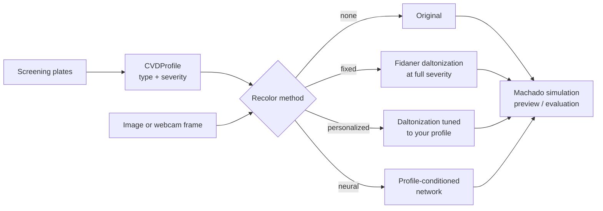

# ChromaFix

**Seeing and fixing the world of color vision deficiency.**

ChromaFix is a web app that screens users for color vision deficiency (CVD), shows others what CVD looks like, and recolors images and live video with a correction tuned to each person's own type and severity.

> CS 4391 Computer Vision · The University of Texas at Dallas · Group 6
> Maintained by Anshika

---

## Why

About 8% of men and 0.4% of women have some form of color vision deficiency [1]. Colors that look clearly different to most people can look identical to them, which hides information in charts, maps, traffic signals, and the difference between ripe and unripe fruit.

Two gaps motivate this project:

- **Most people never learn their exact CVD type.** Screening rarely happens outside a clinic.
- **Existing correction filters are one-size-fits-all.** They apply the same transformation to everyone, which often over-corrects mild cases and makes images look unnatural.

ChromaFix closes both gaps in one place: screen first, then correct for *you*.

---

## Features

| | Feature | What it does |
|---|---|---|
| 🔍 | **Screening** | Generated dot-pattern plates estimate your CVD type (protan, deutan, tritan) and severity. |
| 👁️ | **Simulation** | See any image or live webcam feed the way someone with CVD sees it, at any severity. |
| 🎨 | **Personalized recoloring** | Daltonization tuned to your screening result shifts confusable colors toward ones you can tell apart, while keeping the image natural. |
| 🧠 | **Neural recoloring** *(extension)* | A small network conditioned on your profile, trained without hand-labeled targets. |
| 📹 | **Live mode** | Real-time simulation and correction on webcam video, running in a WebGL shader. |
| 🎮 | **Mini-games** | Compare original, simulated, and recolored versions in quick tasks that also power our user study. |

---

## How it works



**1. Screening.** Plates are built from colors on each CVD type's confusion lines, at several difficulty levels. Every plate is validated by running it through the simulator. Each plate is labeled with the lowest severity at which each CVD type can no longer read it. Your answers are then scored into a `CVDProfile`.

**2. Simulation.** We use the physiologically based model of Machado et al. [3]. It provides a 3×3 matrix per CVD type and severity, applied in linear RGB, and we interpolate between severity steps.

**3. Recoloring.** Daltonization [2] simulates what you see, computes what you're missing, and redistributes that error into channels you can perceive. The fixed version assumes full severity. The personalized version tunes the redistribution to your type and severity, using a held-out tuning set. Both methods reduce to a single 3×3 matrix, which is what makes real-time webcam correction possible.

**4. Evaluation.** All color differences are measured with CIEDE2000.

---

## Team

| Member | Owns |
|---|---|
| **Anshika** | Recoloring: fixed and personalized daltonization, neural recoloring |
| **Avneet Kaur** | Color core, CVD simulation, screening plates and scoring |
| **Aliza Karachiwalla** | Dataset, annotations, metrics, evaluation, study analysis |
| **Iris Le** | API server, web frontend, live webcam mode, mini-games |

---

## Quick start

### Requirements

- Python 3.11
- Node 20
- A webcam (for Live mode)

### Install

```bash
git clone https://github.com/<org>/chromafix.git
cd chromafix

python -m venv .venv
source .venv/bin/activate          # Windows: .venv\Scripts\activate

pip install -e ".[dev]"            # core + dev tools
pip install -e ".[dev,neural]"     # optional: add PyTorch for the neural model
```

### Get the data

Images, plates, webcam clips, and model checkpoints are **not in git**. Download them from the team Google Drive folder and place them at the same relative paths:

```
data/images/     data/plates/     data/clips/     models/
```

`data/manifest.csv` and `data/annotations/pairs.json` *are* in git.

### Run the app

```bash
# Terminal 1: API server on http://localhost:8000
uvicorn server.main:app --reload

# Terminal 2: frontend on http://localhost:5173
cd web
npm install
npm run dev
```

Open http://localhost:5173. Take the screening test, then explore uploads, Live mode, and the games.

> If `models/neural_recolor.pt` is missing, the app still works and hides the neural option.

---

## Using the library

```python
from chromafix.color import load_image, save_image
from chromafix.profile import CVDProfile
from chromafix.simulate import simulate
from chromafix.recolor import recolor

img = load_image("data/images/charts/charts_0012.png")   # linear RGB, float32, [0, 1]
me = CVDProfile(type="deutan", severity=0.6)

seen = simulate(img, me.type, me.severity)                # what I see now
fixed = recolor(img, me, method="personalized")           # corrected for me
seen_fixed = simulate(fixed, me.type, me.severity)        # what I see after correction

save_image("out/seen_fixed.png", seen_fixed)
```

Every image in memory is **linear RGB, float32, shape (H, W, 3), values in [0, 1]**. Convert only at load and save time.

---

## Scripts

| Script | Owner | What it does |
|---|---|---|
| `scripts/make_plates.py` | Avneet | Generate and validate the screening plates → `data/plates/` |
| `scripts/make_simulated_views.py` | Avneet | Protan/deutan/tritan views at severities 0.25, 0.5, 0.75, 1.0 |
| `scripts/tune_personalized.py` | Anshika | Tune personalized daltonization on the tuning split |
| `scripts/train_neural.py` | Anshika | Train the neural recoloring model (run on Colab) |
| `scripts/run_eval.py` | Aliza | All methods × types × severities on the test split → `results/recolor_metrics.csv` |
| `scripts/analyze_study.py` | Aliza | Accuracy and response time per condition from study logs |

Each script supports `--help`.

---

## Dataset

About 200 images in six categories. Roughly a quarter were photographed by the team under varied lighting; the rest come from public sources such as COCO [4].

| Category | Images |
|---|---|
| Charts and graphs | 40 |
| Maps | 30 |
| Traffic signals and road signs | 30 |
| Ripe vs. unripe fruit and food | 40 |
| Color-coded everyday items | 30 |
| Natural scenes (control) | 30 |

- **Annotations:** In about 50 images, we mark pairs of regions that should stay distinguishable, such as a red line and a green line.
- **Splits:** 30 images are held out as the `tune` split. Only these images are used for tuning or model selection. The rest are `test`.
- **Screening stimuli:** 100–200 generated plates across CVD types and difficulty levels.

Source URLs and licenses for every image are listed in `data/manifest.csv`.

---

## Evaluation

| What | How | Metric |
|---|---|---|
| Screening | Run every plate through the simulator as a "virtual observer" at each type and severity | Type accuracy, severity error |
| Distinguishability | CIEDE2000 between annotated region pairs, after simulation | Mean ΔE₀₀ ↑, share of pairs below JND ↓ |
| Naturalness | CIEDE2000 between recolored and original | Mean ΔE₀₀ ↓ |
| User study | 8–12 volunteers play mini-games under each condition | Accuracy ↑, response time ↓ |

We compare four conditions: **no correction**, **fixed daltonization**, **personalized daltonization**, and **neural recoloring** (if built).

**Success** means personalized recoloring beats the fixed filter on distinguishability and naturalness, and volunteers answer faster with it.

### Results

*Coming soon.* Final numbers will be generated by `scripts/run_eval.py` and `scripts/analyze_study.py`.

---

## Repository layout

```
chromafix/
├── chromafix/          # Python package
│   ├── color.py        #   conversions + CIEDE2000
│   ├── simulate.py     #   Machado 2009 simulation
│   ├── profile.py      #   CVDProfile
│   ├── screening/      #   plates, validation, scoring
│   ├── recolor/        #   daltonization + neural model
│   └── eval/           #   metrics + study analysis
├── server/             # FastAPI backend
├── web/                # React + Vite frontend
├── scripts/            # CLI entry points
├── data/               # manifest + annotations (images via Drive)
├── models/             # checkpoints (via Drive)
├── results/            # metrics CSVs, figures, study logs
└── tests/
```

---

## Development

```bash
pytest                       # must pass before merging
ruff check . && ruff format .
```

- Branch as `<name>/<feature>` and open one PR per feature. Another teammate reviews before merge.
- Edit only the module you own. Changes to shared contracts go through a `[contract]` PR approved by all four members.
- Never tune anything on the `test` split.

---

## Privacy

User-study logs contain only an anonymous participant ID, the screening profile, and trial results. The server never stores uploaded images, and no names, emails, or photos of participants are kept in this repository.

---

## Disclaimer

ChromaFix is a course project. Its screening is **not a medical diagnosis**. For a clinical assessment of color vision, see an optometrist or ophthalmologist.

---

## References

1. J. Birch. Worldwide prevalence of red-green color deficiency. *JOSA A*, 29(3):313–320, 2012.
2. O. Fidaner, P. Lin, N. Ozguven. Analysis of color blindness. Psych 221 project report, Stanford University, 2005.
3. G. M. Machado, M. M. Oliveira, L. A. F. Fernandes. A physiologically-based model for simulation of color vision deficiency. *IEEE TVCG*, 15(6):1291–1298, 2009.
4. T.-Y. Lin et al. Microsoft COCO: Common objects in context. *ECCV*, 2014.

## Acknowledgments

Built for CS 4391 Computer Vision, taught by Prof. Yapeng Tian at The University of Texas at Dallas.
